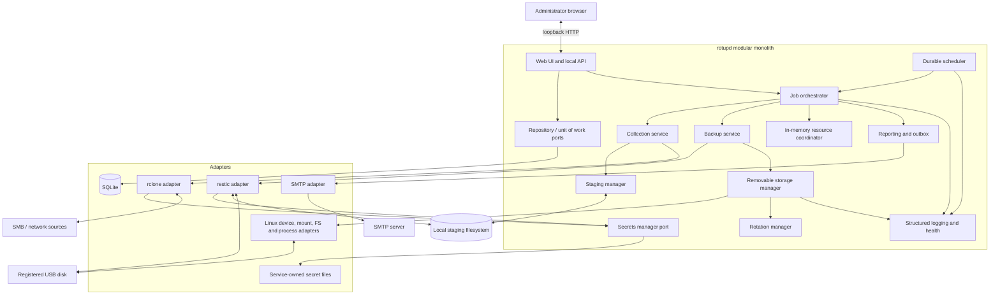
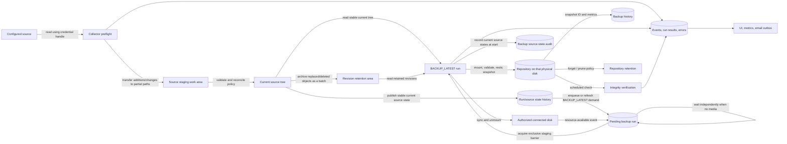
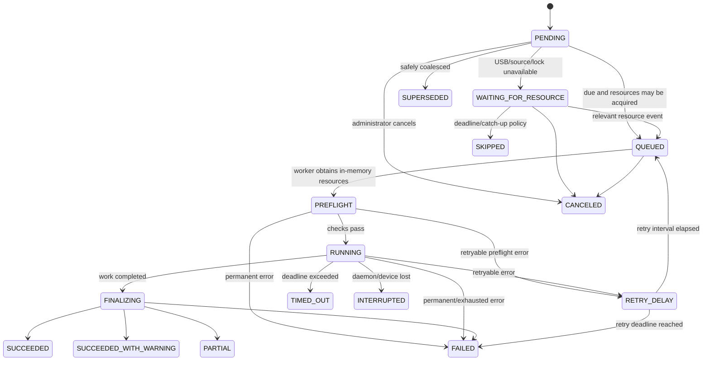

# ROTUP Architecture

Status: **Proposed for architecture review**

This document defines the initial architecture for a clean-room implementation of
ROTUP. It deliberately contains no production implementation. Linux is the v1
runtime target; the boundaries described here are intended to make Windows support
an adapter addition rather than a core rewrite.

## 1. System overview

ROTUP is a single-node, unattended backup orchestrator that runs on a dedicated
backup server. It owns two related but operationally independent pipelines:

1. **Collection pipeline:** configured network sources are reconciled into
   source-specific local staging areas.
2. **Backup pipeline:** a consistent, completed view of staging is snapshotted to
   the repository on whichever registered USB disk is available.

The collection pipeline never requires a USB disk. If no disk is connected,
collection continues and durable `BACKUP_LATEST` requests wait or coalesce until
an authorized disk becomes available. When backup starts, ROTUP holds an exclusive
in-process staging mutation barrier for the entire restic read. Every physical USB
disk has a separate backup repository and history.

ROTUP is initially a modular monolith: one long-running Go daemon owns the
scheduler, orchestration, local HTTP UI/API, SQLite state, device observation, and
external-tool processes. This keeps transactions and recovery understandable on a
single backup server while preserving strict internal component boundaries.

SQLite is the source of truth for configuration, schedules, durable work, state
transitions, and operational history. The filesystem is the source of truth for
staged bytes and backup repository contents. ROTUP continually reconciles these
truths after startup and after device events.

### Capability status

The status labels in this document are normative:

- **REQUIRED_V1:** required for the complete Linux v1 release (milestones M1-M9).
- **PLANNED:** an architectural seam retained now, but working runtime capability
  is not required for the first end-to-end backup release.
- **FUTURE:** must not be implemented merely because it is described here.

| Major capability | Status |
|---|---|
| Single Linux Go daemon, singleton host lock and modular boundaries | **REQUIRED_V1** |
| SQLite control state/history with a minimal v1 schema | **REQUIRED_V1** |
| rclone SMB collection into current/work/revisions staging | **REQUIRED_V1** |
| `BACKUP_LATEST` through restic to one repository per UUID-identified disk | **REQUIRED_V1** |
| Idle-unmounted USB lifecycle and surprise-removal recovery | **REQUIRED_V1** |
| Internal weekday/time scheduler, retries and backup-after-collection | **REQUIRED_V1** |
| Calendar-anchored three-disk A/B/C rotation | **REQUIRED_V1** |
| Server-rendered local UI, structured logs, history and simple health endpoint | **REQUIRED_V1** |
| SMTP reports, retention, integrity checks and hardening | **REQUIRED_V1** |
| Portable hook interfaces without a required runtime implementation | **PLANNED** |
| Stronger OS-backed secret providers | **PLANNED** |
| Production pre/post hook execution | **FUTURE** |
| Windows runtime adapters and Windows service support | **FUTURE** |
| Immutable historical staging generations / CoW snapshot adapter | **FUTURE** |
| Prometheus/advanced telemetry, advanced schedule expressions and remote administration | **FUTURE** |
| Database-backed/distributed leases or multi-node orchestration | **FUTURE** |

## 2. Goals and non-goals

### Goals

- Continue scheduled collection when no USB disk is present.
- Operate unattended through transient network, process, and device failures.
- Identify disks by persistent filesystem UUID and ROTUP metadata, never by an
  unstable device path.
- Make job, run, disk, and rotation transitions explicit and auditable.
- Use mature transfer and snapshot engines behind replaceable interfaces.
- Make retries idempotent where possible and safe where not fully idempotent.
- Preserve enough state to recover deterministically after daemon or host failure.
- Keep credentials out of ordinary configuration rows, process arguments, logs,
  reports, and browser responses.
- Provide useful local UI, structured logs, health state, events, and email reports.
- Keep Linux discovery, mounting, process, path, and credential details out of the
  domain and orchestration packages.

### Non-goals for v1

- Implementing SMB, deduplication, encryption, or snapshot algorithms in ROTUP.
- Providing high availability, clustering, or multi-node scheduling.
- Providing source-side filesystem or application-consistent snapshots where the
  source itself does not expose them.
- Reconstructing or selecting a historical staging tree. v1 backs up only the
  stable current tree that exists when a `BACKUP_LATEST` run starts.
- Requiring a copy-on-write staging filesystem or snapshot adapter.
- Treating staging as a backup by itself.
- Automatically backing up to an unregistered disk.
- Requiring the expected rotation disk when another authorized disk is safe to use.
- Supporting arbitrary shell snippets as hooks.
- Exposing the administrative UI publicly or building a heavy SPA.
- Supporting Windows in v1.
- Replacing rclone/restic repository formats with ROTUP-specific formats.

## 3. Major architectural decisions

### AD-1: One daemon, modular internals

A single `rotupd` process is the v1 deployment unit. Core packages depend on
domain types and ports; adapters depend inward on those ports. No core package
imports SQLite, Linux, rclone, restic, SMTP, or HTTP implementation packages.

### AD-2: Independent durable pipelines

Collection and USB backup have separate run records, resource requirements, retry
policies, and histories. A successful collection may enqueue backup work, but it
does not call a backup engine inline. This prevents missing media from blocking or
failing collection.

### AD-3: v1 backup semantics are BACKUP_LATEST

Collection publishes a stable current staging state. A backup request never names
historical contents; it means “back up the latest stable staging state when this
run acquires the staging barrier.” Multiple automatic requests may coalesce while
media is absent. At backup start ROTUP records which collection result/state was
current for each source, solely for audit. Those records are not recoverable
historical filesystem generations.

### AD-4: Reconciliation policy is explicit

ROTUP does not silently equate collection with destructive mirroring. Every source
has a deletion policy:

- `copy_only`: copy additions and changes; do not propagate source deletions.
- `archive_then_sync`: move displaced/deleted staging objects to a revision area
  before reconciling the current tree.
- `mirror`: propagate deletions only when explicitly enabled and after safety
  checks.

The safe default is `archive_then_sync`. Retention later removes old revisions.

### AD-5: External engines are untrusted subprocess boundaries

rclone and restic are invoked with argument arrays through a process-runner port,
never through a shell. ROTUP validates versions/capabilities, controls environment,
parses machine-readable output, redacts diagnostics, enforces timeouts, and maps
exit results to typed domain errors.

### AD-6: Persistent disk identity and per-disk repositories

The registered filesystem UUID is the primary physical-media identity. The
resolved device node and mount path are ephemeral observations. A ROTUP marker
inside the filesystem adds defense in depth but never substitutes for the UUID.
Each disk contains its own restic repository and therefore its own snapshots,
locks, retention, and verification history.

### AD-7: Event-assisted discovery plus reconciliation

Linux device events provide low-latency insertion/removal notifications. Periodic
enumeration and startup reconciliation are authoritative so dropped or reordered
events cannot leave the state machine stale.

### AD-8: Calendar-anchored rotation

The three-disk sequence is anchored to a configured date, period length, and
timezone. Expected media is derived from the calendar, not advanced by successful
backup, so missed weeks do not permanently shift the sequence. Using another
enabled registered disk creates a warning and event but is allowed. By default it
does not satisfy the expected disk's rotation period.

### AD-9: Durable scheduler, no operating-system job scheduler

The internal scheduler calculates and persists `next_run_at` from selected
weekdays and a local execution time, creates durable runs, applies bounded
catch-up/`BACKUP_LATEST` coalescing, and wakes on relevant resource events.
systemd only starts and supervises the daemon. Cron-like expressions are future.

### AD-10: Minimal SQLite control state, not bulk output

SQLite uses WAL mode, foreign keys, bounded transactions, and a single serialized
write path. Long-running subprocesses never hold database transactions. v1
persists runs, source results, backup results, events, rotation and revision-batch
coverage. It does not persist distributed leases, per-attempt histories,
generation sets, or high-volume logs.

### AD-11: Secure local administration by default

v1 binds the HTTP listener to loopback or a protected Unix socket. Remote
administration is **FUTURE** and requires authentication, CSRF protection, and TLS
directly or through a trusted reverse proxy.

### AD-12: Connected media is unmounted while idle

A registered disk is normally `AVAILABLE_UNMOUNTED` even if it remains physically
connected for a week. ROTUP mounts it only for repository setup, backup,
verification or retention; it syncs and unmounts after each operation.

### AD-13: Single-process coordination

The daemon takes a singleton instance lock. An in-memory coordinator prevents
incompatible operations. SQLite persists run state, not resource leases. Startup
marks stale active runs `INTERRUPTED` and performs operation-specific recovery.

## 4. Component diagram



## 5. Data-flow diagram



The collection-to-backup connection is a durable database demand, not a direct
function call. A disconnected USB device therefore affects only the right side of
the diagram. Audit rows describe what was current when backup started; they do not
identify an immutable historical tree that can be backed up later.

## 6. Component responsibilities

| Component | Owns | Does not own |
|---|---|---|
| Configuration | Validation and typed settings | Secrets or runtime state |
| Repository layer | SQLite transactions, queries, migrations | Business policy |
| Scheduler | Weekday/local-time calculation, catch-up, durable enqueue, wakeups | Job execution |
| Job orchestrator | State transitions, retries, in-memory locks and timeouts | Tool-specific commands |
| Collector | Source preflight and transfer/reconciliation workflow | SMB protocol implementation |
| Staging manager | Layout, partials, stable-current publication, revision-batch safety, space checks | USB availability |
| Backup service | `BACKUP_LATEST` state audit, repository operations, backup metrics, verification/retention coordination | Device discovery/mounting |
| Removable storage manager | Observation, validation, mount lifecycle, disk state machine | Weekly expectation policy |
| Rotation manager | Expected/next disk, due/overdue evaluation and warnings | Blocking an otherwise safe backup |
| Secrets manager | Secret lifecycle and short-lived materialization | Ordinary configuration |
| Reporting | Event-to-report policy, rendering, deduplication, SMTP outbox | Run truth |
| Hook port (**PLANNED**) | Future validated pre/post extension seam | v1 runtime execution |
| Web/API | Local administration, validation, CSRF/auth boundaries | Core business logic |
| Observability | Structured logs, metrics, health endpoints | Durable job decisions |
| Platform adapters | Device, mount, filesystem, process, secret and path mechanics | Domain policy |

### Web UI delivery

The UI uses server-rendered HTML with progressive enhancement (HTMX is optional)
and no client-owned business state. Handlers call application use cases and render
validated view models; they do not call adapters directly. Initial page groups are:

- **Dashboard:** health, active/expected disk, rotation timing, latest runs,
  warnings, capacities and next schedule.
- **Sources:** CRUD, enablement, SMB/staging/rule configuration and an asynchronous
  connection-test run.
- **Disks:** observed/registered media, UUID/filesystem/capacity, registration,
  enablement, repository state and rotation history.
- **Jobs:** CRUD, source membership, selected weekdays/local time,
  retries/timeouts, backup-after-collection, enablement and manual execution.
- **History:** collection/backup summaries, source results, metrics, warnings,
  safe errors and bounded useful paths.
- **Logs:** time/severity/component/job/run filters over retained structured
  records, with links back to history.
- **Settings:** staging, rotation, retention, collector/backup engine, SMTP and
  notification policies. Secret values use separate replace/clear actions.

Mutating forms use POST with CSRF protection and POST-redirect-GET. Long operations
return a durable run ID immediately; pages poll or use server-sent events for
progress. The browser disconnecting never cancels a run.

## 7. Go package/module boundaries

The initial repository remains one Go module. Proposed packages are intentionally
organized by capability rather than technical layer alone:

| Package | Purpose and dependency rule |
|---|---|
| `cmd/rotupd` | Composition root, configuration loading, signal handling only |
| `internal/domain` | IDs, value objects, state enums, typed errors; imports no adapters |
| `internal/ports` | Narrow interfaces implemented by adapters |
| `internal/app` | Daemon lifecycle and dependency wiring |
| `internal/config` | Non-secret configuration parsing/defaulting/validation |
| `internal/orchestrator` | Job/run workflows, resource locks, recovery |
| `internal/scheduler` | Internal schedules, durable enqueue, fake-clock-friendly timing |
| `internal/collector` | Collection use cases and transfer-policy coordination |
| `internal/staging` | Layout, stable current state, reconciliation and revision retention |
| `internal/backup` | Snapshot, verify and repository-retention use cases |
| `internal/removable` | Disk observations and per-disk state machines |
| `internal/rotation` | Calendar rotation evaluation and reminders |
| `internal/reporting` | Report policies, templates and durable outbox |
| `internal/hooks` | **PLANNED:** portable hook port only; no required v1 runtime |
| `internal/secrets` | Secret service and materialization policy |
| `internal/web` | HTTP routes, handlers, templates and middleware |
| `internal/observability` | `slog` setup and simple health endpoint; metrics seam remains future |
| `internal/adapters/sqlite` | SQLite repositories and migrations |
| `internal/adapters/rclone` | Transfer engine adapter |
| `internal/adapters/restic` | Backup engine adapter |
| `internal/adapters/smtp` | Mail sender |
| `internal/platform/linux` | Linux device, mount, FS, paths, process and secrets adapters |
| `internal/platform/windows` | **FUTURE:** Windows implementations of the same ports |

Cross-capability coordination belongs in `orchestrator`, not in adapters. Generic
`util` packages are avoided; shared behavior must have a clear domain owner.

## 8. Important Go interfaces

The following sketches define the intended seams, not final API signatures:

```go
type TransferEngine interface {
    TestConnection(context.Context, SourceSpec, CredentialHandle) error
    Collect(context.Context, TransferRequest, ProgressSink) (TransferResult, error)
}

type StagingManager interface {
    Prepare(context.Context, Source, RunID) (StagingSession, error)
    Reconcile(context.Context, StagingSession, ReconcilePolicy) (PublishedSourceState, error)
    Abort(context.Context, StagingSession) error
    CurrentState(context.Context) ([]PublishedSourceState, error)
    Space(context.Context) (SpaceInfo, error)
}

type BackupEngine interface {
    InspectRepository(context.Context, RepositorySpec, CredentialHandle) (RepositoryInfo, error)
    InitializeRepository(context.Context, RepositorySpec, CredentialHandle) error
    Backup(context.Context, BackupRequest, ProgressSink) (SnapshotResult, error)
    Verify(context.Context, VerifyRequest, ProgressSink) (VerifyResult, error)
    ApplyRetention(context.Context, RetentionRequest, ProgressSink) (RetentionResult, error)
}

type DeviceDiscovery interface {
    Observe(context.Context) (<-chan DeviceEvent, error)
    Enumerate(context.Context) ([]BlockDeviceObservation, error)
}

type FilesystemInspector interface {
    Inspect(context.Context, DeviceRef) (FilesystemInfo, error)
    Space(context.Context, Path) (SpaceInfo, error)
}

type MountManager interface {
    Mount(context.Context, MountRequest) (MountHandle, error)
    Sync(context.Context, MountHandle) error
    Unmount(context.Context, MountHandle) error
    Reconcile(context.Context) ([]MountObservation, error)
}

type ResourceCoordinator interface {
    Acquire(context.Context, []ResourceRequirement) (ReleaseFunc, error)
}

type RotationPolicy interface {
    Evaluate(at time.Time, state RotationState, disks []Disk) RotationEvaluation
}

type SecretStore interface {
    Put(context.Context, SecretMetadata, SecretValue) (CredentialRef, error)
    Materialize(context.Context, CredentialRef, SecretPurpose, func(SecretMaterial) error) error
    Delete(context.Context, CredentialRef) error
}

type ProcessRunner interface {
    Run(context.Context, CommandSpec, OutputConsumer) ProcessResult
}

type MailSender interface {
    Send(context.Context, Message) error
}

type Clock interface {
    Now() time.Time
    NewTimer(time.Duration) Timer
}
```

Repositories are use-case-specific interfaces (for example `RunRepository`,
`DiskRepository`, `ScheduleRepository`, and `EventRepository`), rather than one
large database interface. Transaction composition is exposed through a narrow
`UnitOfWork` port.

Secrets are represented by opaque handles. `Materialize` scopes plaintext to a
callback and lets a provider use an inherited file descriptor or protected
temporary file without returning a long-lived string.

`ResourceCoordinator` is implemented in memory for v1 and exists only to keep
locking policy testable. It is not backed by SQLite and has no fencing epoch or
distributed ownership semantics. A `HookRunner`-like interface is **PLANNED**, but
no production hook runner is required in v1.

## 9. Core domain models

All IDs are opaque typed UUIDs. Timestamps are UTC instants in storage; timezone is
applied only when evaluating human schedules and rotation boundaries.

- **Source:** identity, display name, SMB endpoint, optional subdirectory, username,
  credential reference, relative staging destination, enabled flag, include/exclude
  rules, reconciliation policy and revision retention.
- **Disk:** internal identity, human name, normalized filesystem UUID, filesystem
  type, enabled flag, repository relative path, repository credential reference,
  registration/connection timestamps, last successful backup, last rotation
  period and current state.
- **DeviceObservation:** ephemeral device reference, UUID, filesystem, size,
  read/write status and observation time. It is never treated as configuration.
- **Job:** collection, `BACKUP_LATEST`, verify, or retention intent; selected
  sources; enabled flag; timeout; retry interval/deadline; and
  backup-after-collection policy.
- **Schedule:** selected weekdays, local execution time, timezone, next due time
  and enablement. Advanced expressions are **FUTURE**.
- **Run:** durable execution request plus summarized retry state. Terminal results
  include success, success-with-warning, partial, failure, cancellation, timeout,
  interruption, skip and supersession. v1 does not require per-attempt history.
- **SourceResult / PublishedSourceState:** per-source counts, bytes, status,
  monotonically increasing state version, publication time, warning and safe error
  summary for a collection run. A state version is audit metadata, not an
  immutable filesystem generation.
- **BackupLatestDemand:** durable intent to snapshot whatever stable staging state
  is current after the run acquires the exclusive mutation barrier.
- **BackupSourceState:** audit record of each source state current when restic
  began; it cannot be used to reconstruct old staging contents.
- **RevisionBatch:** run/source-level group of replaced or deleted staging paths,
  creation time, retention eligibility and first successful covering backup.
- **Snapshot:** restic snapshot identity tied to the actual disk and backup run.
- **RotationState:** anchor, timezone, period duration, ordered disk slots, current
  period and last evaluation.
- **Event:** append-only operational fact with severity, type, component, related
  entities and safe JSON payload.
- **RetryPolicy:** fixed retry interval, deadline and retryable error classes.
- **RetentionPolicy:** staging-revision retention plus per-repository snapshot,
  verification, forget and prune policy.
- **CredentialRef:** non-secret provider and locator metadata.

## 10. Source collection model

Each source maps to a unique staging subtree. The collector executes these phases:

1. **Resolve and validate:** load configuration, validate normalized SMB endpoint
   and relative paths, resolve a credential handle, and test staging safety.
2. **Preflight:** test connectivity, check staging reserve space, create a run work
   area, and record the intended reconciliation policy.
3. **Transfer:** invoke the transfer engine with include/exclude rules. New output
   uses partial names or a work directory; completed files are atomically renamed
   within the same filesystem where possible.
4. **Stability handling:** use engine checks based on size/mtime by default and
   optional checksums where practical. Files that change during transfer are
   retried within the attempt budget and reported if they never stabilize.
5. **Reconcile:** apply the configured deletion policy. For
   `archive_then_sync`, displaced and source-deleted paths move to a run-stamped
   revision area before current-tree deletion.
6. **Publish:** record metrics and advance that source's current-state version only
   after reconciliation and required metadata writes complete. Publication is a
   short database transaction after filesystem finalization.
7. **Clean up:** retain bounded diagnostics, remove confirmed partials, and enqueue
   revision cleanup separately.

Source-side writes mean a collection is generally crash-consistent, not an atomic
point-in-time image. Application-consistent collection requires a source snapshot
or a future administrator-defined hook extension. ROTUP must say this clearly in
run results.

A source is marked `UPDATING` while reconciliation can mutate `current`. A failure
before reconciliation leaves the prior current state untouched. A failure during
reconciliation must be completed or rolled back from its work/revision batch
before the source returns to `STABLE`; otherwise it becomes
`RECOVERY_REQUIRED` and is not silently presented as a successful stable state.

A multi-source collection may finish `PARTIAL`. Successful or explicitly accepted
partial sources publish new current-state versions; failed sources retain their
last state metadata or become `RECOVERY_REQUIRED` as above.
Whether a partial collection can trigger backup is a job policy, defaulting to
yes-with-warning so already collected data is not stranded.

## 11. Staging model

The default conceptual layout is:

```text
<staging-root>/
  sources/<source-id>/current/...
  revisions/<source-id>/<run-id>/...
  work/<source-id>/<run-id>/...
  metadata/<source-id>/...
  lost+found/...
```

Only the staging manager constructs these paths. User-supplied staging destinations
are normalized relative paths; absolute escapes, `..` traversal, unsafe symlink
resolution, and overlapping source destinations are rejected.

Key rules:

- `current` holds the latest reconciled view for a source.
- `work` is disposable only after the owning run is terminal and recovery has
  inspected it.
- `revisions` preserves replaced/deleted data according to staging retention.
- Stable-current metadata is written to a temporary file, fsynced where supported,
  atomically renamed, then summarized in SQLite. It is audit/recovery metadata,
  not a historical filesystem version.
- v1 `BACKUP_LATEST` includes `current` plus all active `revisions` for the selected
  sources. Internal transient `work`, `lost+found` and secret material are always
  excluded.
- Replaced/deleted paths from one source reconciliation form a revision batch.
  ROTUP may mark a batch covered only after a successful USB backup that began
  after the batch was created and included that source's revision tree.
- A revision batch is never automatically deleted unless its retention age has
  expired **and** at least one such covering USB backup is recorded. Extended media
  absence therefore extends revision retention automatically.
- After a restic snapshot is confirmed successful, one transaction marks active
  batches covered when their source appears in `backup_source_states` and their
  creation precedes `restic_started_at`. A successful wrong-but-authorized disk
  counts as USB coverage; an ambiguous restic result counts only after recovery
  adopts the snapshot by run tag.
- A configurable reserve and high-water mark protect both the host and SQLite.
  Preflight estimates are advisory; transfers also monitor actual free space.
- Low space pauses new collection safely, emits an alert, and may run only approved
  covered revision expiration. ROTUP does not delete current data or an uncovered
  revision batch to reclaim space.
- Cleanup is idempotent and never follows untrusted symlinks.

Revision protection is run/batch-level. v1 does not build a per-file catalog for
this feature. Immutable historical generations and filesystem snapshot-backed
selection are **FUTURE** capabilities and require a real versioned read view such
as a verified Btrfs, ZFS, LVM, or equivalent CoW adapter.

## 12. USB disk state machine

There is a global connected-media view and a persisted state per registered disk.
Device events are hints; each transition validates the current observation. A
connected disk is normally unmounted while idle.

```mermaid
stateDiagram-v2
    [*] --> DISCONNECTED
    DISCONNECTED --> PHYSICALLY_CONNECTED: block device observed
    PHYSICALLY_CONNECTED --> DETECTED: UUID/filesystem inspected
    DETECTED --> AVAILABLE_UNMOUNTED: registered and enabled
    DETECTED --> ERROR: unknown/disabled/ambiguous

    AVAILABLE_UNMOUNTED --> VALIDATING: backup/verify/maintenance requested
    SAFE_TO_REMOVE --> VALIDATING: new work while still connected
    VALIDATING --> MOUNTING: identity and safety checks pass
    VALIDATING --> ERROR: unsafe or unavailable
    MOUNTING --> READY: mount, UUID, marker, repository and space verified
    MOUNTING --> ERROR: mount or post-mount validation failed

    READY --> BACKUP_RUNNING: BACKUP_LATEST starts
    READY --> VERIFYING: verification-only run
    READY --> MAINTENANCE_RUNNING: retention/maintenance run
    BACKUP_RUNNING --> VERIFYING: backup completed; verification due
    BACKUP_RUNNING --> SYNCING: result recorded; no verification due
    VERIFYING --> SYNCING: result recorded
    MAINTENANCE_RUNNING --> SYNCING: result recorded
    SYNCING --> UNMOUNTING: filesystem sync completed
    SYNCING --> ERROR: sync failed; cleanup still required
    UNMOUNTING --> SAFE_TO_REMOVE: unmount verified
    UNMOUNTING --> ERROR: unmount failed
    SAFE_TO_REMOVE --> AVAILABLE_UNMOUNTED: remains connected
    ERROR --> VALIDATING: explicit retry/reconciliation
    ERROR --> UNMOUNTING: mounted cleanup is possible
    ERROR --> AVAILABLE_UNMOUNTED: error cleared while connected

    PHYSICALLY_CONNECTED --> DISCONNECTED: removed
    DETECTED --> DISCONNECTED: removed
    AVAILABLE_UNMOUNTED --> DISCONNECTED: removed
    SAFE_TO_REMOVE --> DISCONNECTED: removed
    VALIDATING --> DISCONNECTED: removed
    MOUNTING --> DISCONNECTED: removed
    READY --> DISCONNECTED: sudden removal
    BACKUP_RUNNING --> DISCONNECTED: sudden removal / run interrupted
    VERIFYING --> DISCONNECTED: sudden removal / run interrupted
    MAINTENANCE_RUNNING --> DISCONNECTED: sudden removal / run interrupted
    SYNCING --> DISCONNECTED: sudden removal / repository inspection required
    UNMOUNTING --> DISCONNECTED: removed
    ERROR --> DISCONNECTED: removed
```



Additional rules:

- An unregistered UUID is observed and reported but is never automatically mounted
  read/write or used as a target.
- A disabled registered disk is not used.
- A wrong-but-authorized rotation disk follows the normal state machine after a
  prominent warning and event.
- `AVAILABLE_UNMOUNTED` is the normal idle state for a disk that remains connected.
  New work may mount it automatically again.
- Validation re-reads UUID/filesystem data after mounting and verifies that the
  mount is the expected filesystem, not merely the expected path.
- `SAFE_TO_REMOVE` is reached only after repository work, explicit filesystem
  sync, unmount, and verification that the ROTUP-owned mount is gone. It is not a
  guarantee against all hardware caching.
- Sudden removal cancels the subprocess, marks the run interrupted, preserves
  engine diagnostics, and schedules repository inspection when that disk returns.
- Only ROTUP-owned mounts below a dedicated mount root may be automatically
  unmounted.
- ROTUP does not leave the repository mounted after a failed operation when safe
  unmount is still possible. An unmount failure is a prominent error and the UI
  must not claim `SAFE_TO_REMOVE`.

## 13. Job/run state machine



Runs are durable intents. v1 stores aggregate attempt count, retry timing and last
safe error on the run rather than a separate attempt history. A timeout cancels
the context, then sends graceful termination followed by bounded forced
termination through the platform process adapter.

Backup runs with no disk remain `WAITING_FOR_RESOURCE` rather than repeatedly
failing. Once a target disk is mounted and `READY`, the orchestrator acquires the
exclusive in-memory staging mutation barrier, reads the current published source
states, rejects an unhealed `RECOVERY_REQUIRED` source, records stable states for
audit, and runs restic against current staging. It
releases the barrier only after restic exits, then syncs and unmounts the disk.
Multiple automatic `BACKUP_LATEST` requests may coalesce, but superseded runs
remain auditable. Manual runs are not silently coalesced.

Incompatible overlaps are prevented by the in-memory resource coordinator.
Duplicate schedule firings are prevented by a unique idempotency key derived from
job, nominal due time, and trigger kind.

### Initial scheduler and UI contract

**REQUIRED_V1:** the schedule form exposes weekday checkboxes, one local execution
time, timezone, and enabled/disabled. The job form exposes
backup-after-collection, retry interval, retry deadline and timeout. Each job has a
manual-run action. Users never write cron expressions. Interval schedules,
multiple daily windows, jitter and cron-like expressions are **FUTURE**.

## 14. Weekly rotation model

Rotation configuration contains:

- an ordered list of three enabled disk IDs;
- an administrator-selected anchor local date and boundary time;
- a rotation timezone;
- period length (default seven days);
- reminder lead time and overdue grace period.

For evaluation time `t`:

```text
local_date = boundary_adjusted_date_of(t, rotation_timezone, boundary_local_time)
period_number = floor(calendar_days(anchor_local_date, local_date) / period_days)
expected_index = period_number mod number_of_slots
next_index = (expected_index + 1) mod number_of_slots
```

Calendar arithmetic is evaluated in the configured timezone so the UI follows
administrator expectations across DST; stored boundaries are UTC. Tests cover
ambiguous and nonexistent local times.

The current active disk is the authorized disk presently connected, including the
normal `AVAILABLE_UNMOUNTED` state. The expected disk is the slot for the current
period; the expected next disk is the next slot. A successful qualifying backup
records disk and period. If the expected disk has no qualifying backup by the
period deadline plus grace, rotation is overdue.

When a different enabled registered disk appears, ROTUP:

1. records `unexpected_disk` with expected and actual IDs;
2. displays and emails a warning according to notification policy;
3. continues safety validation and permits backup;
4. records that snapshot against the actual disk and current period;
5. does not mark the expected slot fulfilled by default.

Reminders and overdue notifications have durable deduplication keys so a scheduler
loop cannot flood email.

## 15. Error and retry strategy

Errors are typed by **operation**, **class**, **entity**, **retryability**, and
safe diagnostic detail. Classes include configuration, authentication,
unavailable, timeout, cancellation, capacity, integrity, unsafe-device,
external-tool, invariant, and internal.

Retry policy:

- Authentication, invalid configuration, unknown disk, unsafe filesystem, and
  integrity failures are not automatically retried without a state change or
  explicit policy.
- Network unavailability, transient I/O, SQLite busy, and selected external-tool
  exit classes use the job's configured fixed retry interval in v1.
- “No USB disk” waits for a resource event and a low-frequency reconciliation
  timer; it does not consume rapid retry attempts.
- Capacity errors pause until space changes or retention/administrator action
  occurs.
- Scheduled retrying has an explicit deadline; a zero/absent retry policy means one
  attempt. `attempt_count` is retained on the run for audit without a separate
  attempt-history table.
- Tool output is captured with byte limits. Full credentials and secret-bearing
  environment values are never included in an error.
- Partial multi-source success is represented explicitly, never collapsed into a
  generic success.

Idempotency keys protect scheduler enqueue and report emission. Collection retries
reuse or safely inspect the run work area. Restic snapshot creation is treated as
potentially committed if process completion is ambiguous: repository inspection
looks for a snapshot tagged with the run ID before creating another.

## 16. Crash/restart recovery strategy

Startup performs a recovery phase before accepting new work:

1. Open SQLite with foreign keys and busy timeout; apply migrations; run a quick
   integrity check and fail closed on corruption.
2. Acquire a singleton instance lock so two daemons cannot orchestrate the same
   database/staging root.
3. Change every stale `PREFLIGHT`, `RUNNING`, `FINALIZING` or other active run to
   `INTERRUPTED` and record a recovery event. In-memory locks ceased to exist with
   the old process and require no database reconciliation.
4. Inspect collection work directories. Resume only when the transfer adapter can
   prove it is safe; otherwise quarantine them and mark affected `UPDATING` sources
   `RECOVERY_REQUIRED` until reconciliation restores a known stable state.
5. Re-enumerate block devices and mounts. Never trust a persisted device path or
   mount handle. Adopt no writable idle mount: reconcile and unmount ROTUP-owned
   leftovers when safe, and warn about mounts ROTUP does not own.
6. For an interrupted restic operation, inspect the repository and snapshots by
   run tag when that disk is available. Remove stale restic locks only after
   confirming no owning process exists and the repository identity matches.
7. Recompute weekday/time schedule due values. At most one missed automatic run
   is enqueued per job at startup; `BACKUP_LATEST` demand may coalesce.
8. Requeue retryable interrupted runs, wake resource waiters, and resume unsent
   report outbox entries.
9. Re-evaluate rotation, low-space, and overdue conditions.

Filesystem-before-database ambiguity is handled with discoverable run IDs in work
paths, metadata, and restic snapshot tags. Database-before-filesystem ambiguity is
handled by verifying expected artifacts before advancing state. Recovery actions
themselves emit events and are idempotent.

SQLite database and WAL files live on reliable local storage, not on removable
media. The service manager should terminate the whole process control group so
external tools do not survive an ordinary daemon stop.

## 17. Concurrency model

The daemon uses bounded goroutine workers and context cancellation:

- one scheduler loop owns due-time evaluation;
- one device reconciliation loop merges event hints with periodic enumeration;
- a bounded collection worker pool may collect different sources concurrently;
- a bounded backup/maintenance pool executes disk work;
- one asynchronous SQLite write coordinator serializes short write transactions;
- one bounded notification worker drains the SMTP outbox.

The single-process `ResourceCoordinator` uses named in-memory reader/writer locks:

| Operation | In-memory requirements |
|---|---|
| Collect source X | exclusive `source:X` + shared `staging-mutator` |
| Publish stable current state | same source lock + short database transaction |
| Backup staging | exclusive `staging-mutator` + exclusive `disk:X` |
| Verify/retain repository | exclusive `disk:X` |
| Revision cleanup source X | exclusive `source:X` + shared `staging-mutator` |
| Rotation evaluation | no long lock; short state transaction |

Thus different source collections may overlap, but a backup sees no concurrent
staging mutation. v1 holds the exclusive staging barrier for the entire restic
scan; pending collection waits rather than fails. Locks are acquired in a globally
sorted order to avoid deadlocks and are always released with structured cleanup.
The singleton process lock prevents a second coordinator on the same host.

SQLite persists run state but no lock rows. After a crash, startup marks stale
active runs `INTERRUPTED` and uses filesystem/tool inspection plus typed retry
semantics. A CoW snapshot provider that shortens the barrier and any
database-backed lease design are **FUTURE**.

No database transaction spans filesystem I/O, network I/O, email, or a subprocess.
Progress updates are throttled and coalesced to avoid SQLite write amplification.
Backpressure limits queued subprocesses, event persistence, and log delivery.

## 18. Proposed minimal v1 SQLite schema

This is the normative **REQUIRED_V1** schema. It is deliberately an operational
control/history database, not a file catalog or distributed coordination store.
Migrations and repository contract tests must validate it before implementation.
Timestamps are UTC RFC 3339 strings with subsecond precision. IDs are canonical
UUID text. Booleans are constrained integers. JSON columns contain bounded,
versioned, non-secret payloads validated by Go at write boundaries.

```sql
PRAGMA foreign_keys = ON;

CREATE TABLE schema_migrations (
    version          INTEGER PRIMARY KEY,
    name             TEXT NOT NULL,
    checksum         TEXT NOT NULL,
    applied_at       TEXT NOT NULL
);

CREATE TABLE settings (
    key               TEXT PRIMARY KEY,
    value_json        TEXT NOT NULL,
    updated_at        TEXT NOT NULL
);

-- Metadata only. provider_locator addresses a secret in the separate provider.
CREATE TABLE credential_refs (
    id                TEXT PRIMARY KEY,
    display_name      TEXT NOT NULL,
    provider          TEXT NOT NULL,
    provider_locator  TEXT NOT NULL,
    purpose           TEXT NOT NULL,
    created_at        TEXT NOT NULL,
    updated_at        TEXT NOT NULL,
    last_used_at      TEXT,
    UNIQUE (provider, provider_locator)
);

CREATE TABLE sources (
    id                         TEXT PRIMARY KEY,
    name                       TEXT NOT NULL UNIQUE,
    host                       TEXT NOT NULL,
    share_name                 TEXT NOT NULL,
    subdirectory               TEXT,
    username                   TEXT,
    credential_ref_id          TEXT REFERENCES credential_refs(id)
                                      ON DELETE RESTRICT,
    staging_relative_path      TEXT NOT NULL UNIQUE,
    enabled                    INTEGER NOT NULL DEFAULT 1
                                      CHECK (enabled IN (0, 1)),
    include_rules_json         TEXT NOT NULL DEFAULT '[]',
    exclude_rules_json         TEXT NOT NULL DEFAULT '[]',
    reconciliation_policy      TEXT NOT NULL DEFAULT 'archive_then_sync'
                                      CHECK (reconciliation_policy IN
                                          ('copy_only', 'archive_then_sync', 'mirror')),
    revision_retention_days    INTEGER NOT NULL DEFAULT 30
                                      CHECK (revision_retention_days >= 0),
    staging_status             TEXT NOT NULL DEFAULT 'EMPTY'
                                      CHECK (staging_status IN (
                                          'EMPTY', 'UPDATING', 'STABLE',
                                          'RECOVERY_REQUIRED')),
    staging_state_version      INTEGER NOT NULL DEFAULT 0
                                      CHECK (staging_state_version >= 0),
    last_published_at          TEXT,
    last_collection_run_id     TEXT REFERENCES runs(id) ON DELETE SET NULL,
    options_json               TEXT NOT NULL DEFAULT '{}',
    created_at                 TEXT NOT NULL,
    updated_at                 TEXT NOT NULL
);

CREATE TABLE disks (
    id                         TEXT PRIMARY KEY,
    name                       TEXT NOT NULL UNIQUE,
    filesystem_uuid            TEXT NOT NULL UNIQUE COLLATE NOCASE,
    filesystem_type            TEXT NOT NULL,
    enabled                    INTEGER NOT NULL DEFAULT 1
                                      CHECK (enabled IN (0, 1)),
    repository_relative_path   TEXT NOT NULL DEFAULT '.rotup/repository',
    repository_credential_ref_id TEXT REFERENCES credential_refs(id)
                                      ON DELETE RESTRICT,
    first_registered_at        TEXT NOT NULL,
    last_connected_at          TEXT,
    last_disconnected_at       TEXT,
    last_successful_backup_at  TEXT,
    last_rotation_period       INTEGER,
    current_status             TEXT NOT NULL DEFAULT 'DISCONNECTED'
                                      CHECK (current_status IN (
                                          'DISCONNECTED', 'PHYSICALLY_CONNECTED',
                                          'DETECTED', 'AVAILABLE_UNMOUNTED',
                                          'VALIDATING', 'MOUNTING', 'READY',
                                          'BACKUP_RUNNING', 'VERIFYING',
                                          'MAINTENANCE_RUNNING', 'SYNCING',
                                          'UNMOUNTING', 'SAFE_TO_REMOVE', 'ERROR')),
    last_error_code            TEXT,
    updated_at                 TEXT NOT NULL
);

CREATE TABLE jobs (
    id                         TEXT PRIMARY KEY,
    name                       TEXT NOT NULL UNIQUE,
    kind                       TEXT NOT NULL CHECK (kind IN (
                                          'COLLECTION', 'BACKUP_LATEST',
                                          'VERIFY', 'RETENTION')),
    enabled                    INTEGER NOT NULL DEFAULT 1
                                      CHECK (enabled IN (0, 1)),
    backup_after_collection    INTEGER NOT NULL DEFAULT 0
                                      CHECK (backup_after_collection IN (0, 1)),
    partial_triggers_backup    INTEGER NOT NULL DEFAULT 1
                                      CHECK (partial_triggers_backup IN (0, 1)),
    timeout_seconds            INTEGER NOT NULL CHECK (timeout_seconds > 0),
    retry_interval_seconds     INTEGER NOT NULL DEFAULT 300
                                      CHECK (retry_interval_seconds >= 0),
    retry_deadline_seconds     INTEGER CHECK (retry_deadline_seconds > 0),
    options_json               TEXT NOT NULL DEFAULT '{}',
    created_at                 TEXT NOT NULL,
    updated_at                 TEXT NOT NULL
);

CREATE TABLE schedules (
    id                         TEXT PRIMARY KEY,
    job_id                     TEXT NOT NULL REFERENCES jobs(id)
                                      ON DELETE CASCADE,
    enabled                    INTEGER NOT NULL DEFAULT 1
                                      CHECK (enabled IN (0, 1)),
    days_of_week_mask          INTEGER NOT NULL
                                      CHECK (days_of_week_mask BETWEEN 1 AND 127),
    local_time                 TEXT NOT NULL,
    timezone                   TEXT NOT NULL,
    last_nominal_run_at        TEXT,
    next_run_at                TEXT,
    created_at                 TEXT NOT NULL,
    updated_at                 TEXT NOT NULL
);

CREATE INDEX idx_schedules_due
    ON schedules(enabled, next_run_at);

CREATE TABLE job_sources (
    job_id                     TEXT NOT NULL REFERENCES jobs(id)
                                      ON DELETE CASCADE,
    source_id                  TEXT NOT NULL REFERENCES sources(id)
                                      ON DELETE RESTRICT,
    position                   INTEGER NOT NULL DEFAULT 0,
    PRIMARY KEY (job_id, source_id)
);

-- Durable intent and summarized retry/history state.
CREATE TABLE runs (
    id                         TEXT PRIMARY KEY,
    job_id                     TEXT REFERENCES jobs(id) ON DELETE SET NULL,
    schedule_id                TEXT REFERENCES schedules(id)
                                      ON DELETE SET NULL,
    parent_run_id              TEXT REFERENCES runs(id)
                                      ON DELETE SET NULL,
    kind                       TEXT NOT NULL CHECK (kind IN (
                                          'CONNECTION_TEST', 'COLLECTION',
                                          'BACKUP_LATEST', 'DISK_SETUP',
                                          'VERIFY', 'RETENTION')),
    trigger_kind               TEXT NOT NULL CHECK (trigger_kind IN (
                                          'SCHEDULED', 'MANUAL', 'COLLECTION_SUCCESS',
                                          'DEVICE_AVAILABLE', 'RECOVERY', 'RETRY')),
    nominal_due_at             TEXT,
    idempotency_key            TEXT UNIQUE,
    status                     TEXT NOT NULL CHECK (status IN (
                                          'PENDING', 'WAITING_FOR_RESOURCE', 'QUEUED',
                                          'PREFLIGHT', 'RUNNING', 'FINALIZING',
                                          'RETRY_DELAY', 'SUCCEEDED',
                                          'SUCCEEDED_WITH_WARNING', 'PARTIAL',
                                          'FAILED', 'TIMED_OUT', 'INTERRUPTED',
                                          'CANCELED', 'SKIPPED', 'SUPERSEDED')),
    waiting_reason             TEXT,
    priority                   INTEGER NOT NULL DEFAULT 0,
    attempt_count              INTEGER NOT NULL DEFAULT 0,
    retry_not_before           TEXT,
    retry_deadline_at          TEXT,
    requested_at               TEXT NOT NULL,
    started_at                 TEXT,
    finished_at                TEXT,
    superseded_by_run_id       TEXT REFERENCES runs(id)
                                      ON DELETE SET NULL,
    last_error_class           TEXT,
    last_error_code            TEXT,
    last_safe_error            TEXT,
    summary_json               TEXT NOT NULL DEFAULT '{}',
    updated_at                 TEXT NOT NULL
);

CREATE INDEX idx_runs_dispatch
    ON runs(status, retry_not_before, priority, requested_at);
CREATE INDEX idx_runs_job_time
    ON runs(job_id, requested_at);

CREATE TABLE backup_runs (
    run_id                     TEXT PRIMARY KEY REFERENCES runs(id)
                                      ON DELETE CASCADE,
    disk_id                    TEXT REFERENCES disks(id)
                                      ON DELETE RESTRICT,
    semantics                  TEXT NOT NULL DEFAULT 'BACKUP_LATEST'
                                      CHECK (semantics = 'BACKUP_LATEST'),
    staging_lock_acquired_at   TEXT,
    restic_started_at          TEXT,
    engine_snapshot_id         TEXT,
    repository_id              TEXT,
    bytes_scanned              INTEGER NOT NULL DEFAULT 0,
    bytes_added                INTEGER NOT NULL DEFAULT 0,
    files_new                  INTEGER NOT NULL DEFAULT 0,
    files_changed              INTEGER NOT NULL DEFAULT 0,
    files_unmodified           INTEGER NOT NULL DEFAULT 0,
    verification_status        TEXT,
    rotation_period            INTEGER,
    unexpected_rotation_disk   INTEGER NOT NULL DEFAULT 0
                                      CHECK (unexpected_rotation_disk IN (0, 1))
);

CREATE INDEX idx_backup_runs_disk
    ON backup_runs(disk_id, run_id);

CREATE TABLE run_source_results (
    collection_run_id          TEXT NOT NULL REFERENCES runs(id)
                                      ON DELETE CASCADE,
    source_id                  TEXT NOT NULL REFERENCES sources(id)
                                      ON DELETE RESTRICT,
    status                     TEXT NOT NULL,
    staging_state_version      INTEGER CHECK (staging_state_version >= 1),
    published_at               TEXT,
    started_at                 TEXT,
    finished_at                TEXT,
    bytes_scanned              INTEGER NOT NULL DEFAULT 0,
    bytes_copied               INTEGER NOT NULL DEFAULT 0,
    files_scanned              INTEGER NOT NULL DEFAULT 0,
    files_copied               INTEGER NOT NULL DEFAULT 0,
    files_changed              INTEGER NOT NULL DEFAULT 0,
    files_deleted_or_archived  INTEGER NOT NULL DEFAULT 0,
    warnings_json              TEXT NOT NULL DEFAULT '[]',
    useful_paths_json          TEXT NOT NULL DEFAULT '[]',
    PRIMARY KEY (collection_run_id, source_id)
);

CREATE UNIQUE INDEX idx_run_source_state_version
    ON run_source_results(source_id, staging_state_version)
    WHERE staging_state_version IS NOT NULL;

-- Audit of what was current when a BACKUP_LATEST run actually started.
CREATE TABLE backup_source_states (
    backup_run_id              TEXT NOT NULL REFERENCES backup_runs(run_id)
                                      ON DELETE CASCADE,
    source_id                  TEXT NOT NULL REFERENCES sources(id)
                                      ON DELETE RESTRICT,
    current_collection_run_id  TEXT NOT NULL REFERENCES runs(id)
                                      ON DELETE RESTRICT,
    staging_state_version      INTEGER NOT NULL CHECK (staging_state_version >= 1),
    published_at               TEXT NOT NULL,
    PRIMARY KEY (backup_run_id, source_id)
);

-- One row protects a run/source-level archived batch; this is not a file catalog.
CREATE TABLE revision_batches (
    id                         TEXT PRIMARY KEY,
    source_id                  TEXT NOT NULL REFERENCES sources(id)
                                      ON DELETE RESTRICT,
    collection_run_id          TEXT NOT NULL REFERENCES runs(id)
                                      ON DELETE RESTRICT,
    relative_path              TEXT NOT NULL UNIQUE,
    created_at                 TEXT NOT NULL,
    eligible_after             TEXT NOT NULL,
    item_count                 INTEGER NOT NULL DEFAULT 0,
    byte_count                 INTEGER NOT NULL DEFAULT 0,
    status                     TEXT NOT NULL DEFAULT 'ACTIVE'
                                      CHECK (status IN ('ACTIVE', 'DELETED')),
    covered_by_backup_run_id   TEXT REFERENCES backup_runs(run_id)
                                      ON DELETE RESTRICT,
    covered_at                 TEXT,
    deleted_at                 TEXT,
    CHECK ((covered_by_backup_run_id IS NULL AND covered_at IS NULL)
        OR (covered_by_backup_run_id IS NOT NULL AND covered_at IS NOT NULL)),
    CHECK (status <> 'DELETED'
        OR (covered_by_backup_run_id IS NOT NULL AND deleted_at IS NOT NULL))
);

CREATE INDEX idx_revision_batches_cleanup
    ON revision_batches(status, eligible_after, covered_at);

CREATE TABLE events (
    id                         INTEGER PRIMARY KEY AUTOINCREMENT,
    occurred_at                TEXT NOT NULL,
    severity                   TEXT NOT NULL
                                      CHECK (severity IN ('DEBUG', 'INFO', 'WARNING', 'ERROR', 'CRITICAL')),
    event_type                 TEXT NOT NULL,
    component                  TEXT NOT NULL,
    source_id                  TEXT REFERENCES sources(id) ON DELETE SET NULL,
    disk_id                    TEXT REFERENCES disks(id) ON DELETE SET NULL,
    job_id                     TEXT REFERENCES jobs(id) ON DELETE SET NULL,
    run_id                     TEXT REFERENCES runs(id) ON DELETE SET NULL,
    deduplication_key          TEXT,
    payload_json               TEXT NOT NULL DEFAULT '{}',
    acknowledged_at            TEXT
);

CREATE INDEX idx_events_recent ON events(occurred_at DESC);
CREATE INDEX idx_events_filter ON events(severity, component, occurred_at DESC);
CREATE INDEX idx_events_dedup
    ON events(deduplication_key, occurred_at DESC);

CREATE TABLE rotation_state (
    singleton_id               INTEGER PRIMARY KEY CHECK (singleton_id = 1),
    anchor_local_date          TEXT NOT NULL,
    boundary_local_time        TEXT NOT NULL DEFAULT '00:00:00',
    timezone                   TEXT NOT NULL,
    period_days                INTEGER NOT NULL DEFAULT 7 CHECK (period_days > 0),
    reminder_lead_seconds      INTEGER NOT NULL DEFAULT 172800 CHECK (reminder_lead_seconds >= 0),
    overdue_grace_seconds      INTEGER NOT NULL DEFAULT 0 CHECK (overdue_grace_seconds >= 0),
    current_period_number      INTEGER NOT NULL,
    expected_disk_id           TEXT REFERENCES disks(id) ON DELETE RESTRICT,
    current_active_disk_id     TEXT REFERENCES disks(id) ON DELETE SET NULL,
    period_started_at          TEXT NOT NULL,
    period_due_at              TEXT NOT NULL,
    last_evaluated_at          TEXT NOT NULL,
    updated_at                 TEXT NOT NULL
);

CREATE TABLE rotation_slots (
    slot_index                 INTEGER PRIMARY KEY CHECK (slot_index >= 0),
    disk_id                    TEXT NOT NULL UNIQUE REFERENCES disks(id)
                                      ON DELETE RESTRICT
);

-- Added in the M7 reporting slice; intentionally a small delivery queue.
CREATE TABLE email_outbox (
    id                         TEXT PRIMARY KEY,
    event_id                   INTEGER REFERENCES events(id) ON DELETE SET NULL,
    deduplication_key          TEXT NOT NULL UNIQUE,
    recipient                  TEXT NOT NULL,
    status                     TEXT NOT NULL
                                      CHECK (status IN ('PENDING', 'SENDING', 'SENT', 'FAILED', 'SUPPRESSED')),
    attempt_count              INTEGER NOT NULL DEFAULT 0,
    next_attempt_at            TEXT,
    subject                    TEXT NOT NULL,
    text_body                  TEXT NOT NULL,
    last_safe_error            TEXT,
    created_at                 TEXT NOT NULL,
    sent_at                    TEXT,
    updated_at                 TEXT NOT NULL
);

CREATE INDEX idx_email_outbox_due
    ON email_outbox(status, next_attempt_at);
```

The migration that inserts `rotation_state` enforces exactly three slots at the
application transaction boundary for v1. Rotation fulfillment is derived from
successful `backup_runs` and their `rotation_period`; a separate period-history
table is unnecessary.

Run metrics use integers large enough for byte counts. The database stores only
bounded “useful paths” and summaries; it is not a file catalog. Sensitive tool
output and credentials are forbidden in all JSON payloads. Retention and
notification preferences are small versioned values in `settings`. Structured
logs remain in journald/rotated files rather than SQLite.

Explicitly absent from v1 are generation-set tables, operation lease/fencing
tables, detailed attempt-history tables, hook tables and high-volume log tables.
The few tables beyond the requested core are directly justified:
`schema_migrations` upgrades safely; `job_sources` represents job/source
selection; `backup_source_states` provides the required backup-start audit;
`revision_batches` enforces backup-before-cleanup; and `email_outbox` provides
bounded crash-safe SMTP delivery.

## 19. Migration strategy

- Migrations are immutable, monotonically numbered SQL files embedded in the
  daemon binary. `schema_migrations` records name, checksum and application time.
- Startup takes the singleton application lock before migration and refuses to run
  if an applied checksum differs or the database is newer than the binary.
- Each compatible migration runs in a transaction. Migrations requiring table
  rebuilds use SQLite's create-copy-verify-swap pattern and explicit foreign-key
  checks.
- Before a risky migration, ROTUP creates a consistent local database backup using
  the SQLite backup API, verifies it can be opened, and applies configured backup
  retention. Copying a live database file directly is forbidden.
- Migrations are forward-only in production. Rollback means restoring the verified
  pre-migration database with the matching older binary during an explicit
  administrator procedure.
- Data backfills are bounded and restartable. Long backfills use a schema phase,
  an application-compatible incremental phase, and a final constraint phase.
- CI applies every migration from an empty database and upgrades fixtures from
  every supported prior release, then runs `foreign_key_check` and integrity
  checks.

No migration is needed to write this architecture document, and no migration file
is created in this phase.

## 20. Logging strategy

ROTUP uses Go's structured logging API with stable fields and injectable sinks.
Production output is JSON to stdout/journald by default, with an optional
size/age-rotated file sink. Human console formatting is for development only.

Every relevant record includes:

- UTC timestamp, severity, component, event name and safe message;
- instance ID, job ID, run ID, attempt number and trigger when applicable;
- source ID, disk ID, rotation period and external-tool operation when applicable;
- duration and bounded metric summaries at completion;
- stable error class/code and retryability, not just a free-form error string.

Correlation IDs are created at the durable run boundary and propagated through
contexts. Tool stdout/stderr is parsed as data, size bounded, and redacted before
logging. Known secret values, credential fields, URLs containing credentials,
SMTP authentication, environment blocks, and raw HTTP form bodies are never
logged.

Operational events and logs are distinct: events are durable administrator-facing
facts in SQLite; logs explain execution and remain in journald or bounded rotated
JSON files. A read-only log adapter supplies recent time/severity/component/job/run
filtering to the UI without copying high-volume logs into SQLite. Retention is
configured by age and size.

## 21. Metrics and observability strategy

**REQUIRED_V1:** the dashboard combines durable run/event summaries with direct,
bounded health observations:

- scheduler queue depth, overdue schedules and dispatch latency;
- runs by kind/status, retry count and duration;
- per-source last success age, bytes/files copied and consecutive failures;
- staging capacity/free/reserved bytes and revision/work-area size;
- active/expected disk, disk-state transitions and rotation overdue seconds;
- per-disk last backup age, free bytes, backup duration/bytes and snapshot result;
- integrity check age/failures and retention/prune results;
- SQLite availability and pending email count.

A single local `/healthz` endpoint is sufficient initially. It reports daemon,
database, scheduler and staging health plus degraded source/media summaries. An
intentionally absent USB disk does not make the daemon unhealthy, and health never
requires a network share to be reachable.

**FUTURE:** Prometheus export, histograms, tracing, separate live/readiness
endpoints and advanced telemetry. The observability package keeps a narrow metrics
sink seam so these can be added without changing domain workflows.

## 22. Email/reporting architecture

**REQUIRED_V1 (M7):** domain services emit events and completed run summaries. A
small report-policy component
maps them to report types: successful collection/backup, warning, failure, missing
disk, unexpected disk, rotation reminder/overdue, low space, and verification
failure.

Report creation and delivery are decoupled:

1. In the same short transaction that records a qualifying event/result, reporting
   inserts a durable outbox item with a deterministic deduplication key.
2. A renderer builds plain text and minimal HTML from safe structured data.
3. An outbox worker obtains SMTP credentials through `SecretStore` and sends with
   timeout and TLS policy.
4. Success or bounded retry state is persisted. Repeated delivery failure emits a
   local event without recursively creating another email.

Reports include source success/failure counts, bytes/files, duration, actual disk,
snapshot ID where useful, warnings and safe error summaries. They include only a
bounded number of copied paths and never include credentials or raw tool output.

v1 uses a configured recipient list, enabled report-type flags, deterministic
deduplication and bounded retry. State-based alerts such as “missing disk” and “low
space” send on transition and configured reminder interval rather than every
scheduler tick. Quiet hours, escalation chains and complex grouping are
**FUTURE**. SMTP server, port, sender and TLS mode are ordinary settings;
password/client-key material is a credential reference.

## 23. Secrets/credential strategy

SQLite stores only `credential_refs` metadata. The `SecretStore` port isolates
provider selection and returns short-lived material through a callback.

Preferred Linux v1 design:

- store each secret under an opaque ID in a dedicated service-owned directory
  outside SQLite, staging, removable media and web roots;
- create the directory with mode `0700` and secret files with mode `0600` (or
  stricter), owned by the dedicated service identity;
- use exclusive creation, atomic replacement and fsync; never derive filenames
  from a source name, hostname or user-provided path;
- rely on host filesystem permissions and administrator-provided full-disk
  protection for v1 rather than designing application cryptography whose key
  resides on the same unattended host.

The secret location is excluded from backup-source selection, UI downloads, logs
and reports. A stronger headless provider such as systemd credentials is
**PLANNED** behind the same `SecretStore` abstraction.

For rclone/restic, secret material is passed through an inherited descriptor,
standard input, or a root-only runtime file when the tool requires a path.
Runtime files live in a private volatile directory, are created with exclusive
permissions, are never placed in staging or on USB media, and are removed after
the child exits. Secrets are not placed directly in arguments or the global
process environment.

Secret reads, updates and deletions emit audit events containing reference ID and
purpose but not value. Deleting an in-use reference is rejected. Rotation creates
or updates provider material atomically, tests it where possible, then changes the
active reference. Browser forms never echo stored secrets; an empty edit means
“unchanged,” not “clear.”

Restic repository setup requires an explicit administrator-controlled escrow
procedure. The administrator supplies or records the repository recovery secret in
an external password manager/off-host record and acknowledges recovery readiness
during disk setup. ROTUP never returns the stored secret to the browser after
creation and never treats a lost repository password as a reason to initialize a
new repository automatically.

## 24. Security considerations

- Run as a dedicated service identity with the smallest practical privileges.
  Mounting may require a narrowly scoped privileged adapter/helper; the web and
  orchestration surface must not gain general-purpose root command execution.
- Bind v1 HTTP to loopback or a protected Unix socket. A **FUTURE** non-loopback
  mode requires authenticated sessions, secure cookies, CSRF tokens, Origin/Host
  validation, request limits and TLS or a correctly configured trusted proxy.
- v1 has one administrative role. All configuration mutation, manual runs, disk
  registration and secret changes are auditable.
- Validate and normalize every source, staging, repository and mount-relative path.
  Prevent traversal, symlink escape, source overlap, repository inclusion, and
  staging-to-itself copy loops.
- Build subprocesses from typed argument arrays. Do not invoke a shell. Allowlist
  executable paths and verify owner/mode; clear inherited environment except for
  an explicit minimal set.
- Hook execution is not part of **REQUIRED_V1**. Any later implementation must use
  an explicit executable plus argument array, timeouts/output bounds and a
  restricted identity; arbitrary shell text remains forbidden.
- Mount registered media with `nodev`, `nosuid` and `noexec` where supported.
  Reject unexpected filesystem identity, read-only state when writes are required,
  and unsafe mount destinations. Never execute content from a backup disk.
- Repository marker content is untrusted input. UUID registration plus repository
  identity validation prevents simple marker spoofing.
- Protect database, logs, configuration and credential files with restrictive
  ownership/modes. Redact backups of ROTUP's own control directory unless a
  deliberate self-backup design is approved.
- Use restic repository encryption and authenticated data. A repository password
  loss is unrecoverable; document and test an administrator-controlled escrow
  procedure.
- Require secure SMB negotiation and SMTP TLS policy. Certificate verification is
  on by default; insecure exceptions are explicit, warned and audited.
- Apply dependency, Go toolchain and external-binary update policy with version
  pinning and vulnerability review.
- Treat UI text derived from paths/tool output as untrusted and HTML-escape it.
  Apply CSP and avoid inline script where practical.
- Denial-of-service controls include bounded workers, output, request bodies,
  copied-path lists and event queues.

## 25. Linux-specific adapter boundaries

**REQUIRED_V1:** Linux behavior is contained below `internal/platform/linux` and
implements generic ports:

| Linux capability | Adapter responsibility |
|---|---|
| Device discovery | Subscribe to udev block-device events; periodically enumerate sysfs/udev state |
| Filesystem identity | Read UUID/type using libudev/blkid-compatible data and normalize it |
| Mount lifecycle | Resolve the current device from UUID, mount below ROTUP's root only for work, verify it, sync/unmount it, and enforce idle-unmounted state |
| Space/filesystem data | Use `statfs` and mount information, returning portable value objects |
| Process lifecycle | Start argument arrays in a process group, stream bounded output, send TERM then KILL, reap children |
| Paths/permissions | Supply conventional state/config/runtime roots and enforce owner/mode |
| Credentials | Enforce the service-owned secret directory/files and protected runtime materialization |
| Service/watchdog | Notify systemd readiness/watchdog without putting service policy in the domain |

Device discovery combines events with enumeration because event delivery is not a
durable queue. The adapter returns an opaque `DeviceRef`; only the adapter may turn
that into a current device node. Device paths are never persisted as disk identity.

The preferred mount model is a dedicated root such as
`/run/rotup/media/<disk-id>` with explicit safe options and post-mount UUID
verification. Whether v1 mounts through direct syscalls, a small privileged
helper, or a system service such as udisks2 must be selected after a security and
deployment prototype. The port and state machine do not change with that choice.

Build-tagged composition selects Linux adapters once. Runtime `GOOS` branches are
not scattered through core packages.

## 26. Future Windows portability strategy

**FUTURE:** core domain, scheduler, orchestrator, SQLite repositories, web UI, rotation,
reporting, rclone/restic protocols and state machines remain platform-neutral.
Windows support supplies adapters for:

- removable-volume notifications and periodic enumeration;
- stable volume identity (validated volume GUID/filesystem identifiers rather than
  drive letters);
- mount points or volume paths and free-space inspection;
- Windows service lifecycle and recovery;
- process creation, Job Objects, cancellation and output streaming;
- protected credentials, likely DPAPI/service-account-backed storage;
- ACLs, atomic filesystem operations, path normalization and long paths;
- later hook execution without assuming POSIX shell semantics.

Paths crossing core boundaries use typed relative paths and adapter-owned absolute
paths. Persisted source SMB endpoint fields are semantic fields, not a prebuilt UNC
or POSIX string. Time, signals, permissions and mount concepts use capability
interfaces rather than emulated POSIX assumptions.

When a Windows adapter exists, platform contract tests run against both
implementations. Unsupported filesystem capabilities are returned explicitly and
influence policy; they are not guessed from platform name.

## 27. External-tool integration strategy for rclone/restic

### Common process protocol

- Discover binaries from explicit configured paths; do not trust an arbitrary
  service `PATH`.
- On startup and configuration change, run version/capability probes and publish a
  degraded health state if requirements are not met.
- Use machine-readable output where the tool supports it; keep parsers
  version-aware and fixture-tested.
- Tag operations with ROTUP run IDs in tool-supported metadata.
- Stream progress through a throttled `ProgressSink` and retain bounded sanitized
  diagnostic tails.
- Enforce context deadlines and platform-specific process-tree termination.
- Classify exit codes and parsed errors into stable ROTUP error classes.
- Never build a command string or expose a secret in arguments/logs.

### rclone adapter

- Build the SMB remote configuration transiently from `SourceSpec` and a credential
  handle; do not persist generated plaintext configuration in SQLite.
- Start with the `copy`/`sync` semantics appropriate to the selected reconciliation
  policy, using partial/temp support and backup-directory behavior when verified.
- Pin safety-affecting flags in adapter code rather than accepting arbitrary
  administrator flag text.
- Parse stats for bytes/files/checks/errors and retain a bounded useful-path list.
- Provide connection-test and collection operations separately.
- Explicitly test behavior for source files changing during read, clock skew,
  case collisions, unsupported names, symlinks, deletes and interrupted transfers.

Exact rclone commands are intentionally not specified until an integration spike
proves their semantics against the staging policies.

### restic adapter

- Each disk repository lives under its configured relative path and has a stable
  repository identity recorded after initialization.
- Initialize only through an explicit disk-registration/admin workflow; an
  ordinary backup never silently replaces or reinitializes a missing repository.
- Backups use tags for disk ID, ROTUP run ID, `BACKUP_LATEST` semantics and schema
  version. The `backup_source_states` rows separately record the source states
  current at start. On ambiguous completion, search the run tag before retrying.
- Use restic snapshot operations for incremental, deduplicated history. Capture
  snapshot ID and summary.
- Run `check` on a configurable schedule and after suspicious interruption where
  safe. Repository unlock is guarded by owner/process and identity checks.
- Implement `forget` and `prune` as separately recorded maintenance operations.
  Prune is space-intensive/destructive and requires stricter preflight, exclusive
  in-memory disk ownership and sudden-removal handling.
- Inspect free space before backup/maintenance, while recognizing deduplication
  makes required-space estimates approximate.
- Repository password material follows the secret-materialization rules. Cache
  directories live on protected local storage, not staging.
- Every repository operation follows validate, mount, operate, sync and unmount.
  A physically connected disk returns to `AVAILABLE_UNMOUNTED` after completion.

ROTUP must remain useful if tool output formats evolve: unsupported versions
degrade safely and produce an actionable event instead of guessing.

## 28. Proposed project directory structure

This is a target structure, not a request to create it during architecture review:

```text
rotup/
  cmd/
    rotupd/
  docs/
    ARCHITECTURE.md
    operations/                 # later: install, recovery, disk rotation runbooks
  internal/
    app/
    domain/
    ports/
    config/
    orchestrator/
    scheduler/
    collector/
    staging/
    backup/
    removable/
    rotation/
    reporting/
    hooks/                       # PLANNED extension, not required v1 runtime
    secrets/
    web/
      templates/
      static/
    observability/
    adapters/
      sqlite/
        migrations/
      rclone/
      restic/
      smtp/
    platform/
      linux/
      windows/                  # future
  test/
    integration/
    fixtures/
    fault/
  packaging/
    systemd/
  go.mod
  go.sum
```

Only `docs/ARCHITECTURE.md` is added in this phase.

## 29. Test strategy

### Unit and property tests

- Pure state-machine transition tables for disk and run states.
- Rotation evaluation using a fake clock across anchors, missed periods, leap
  dates, timezone changes and DST boundaries.
- Scheduler due/catch-up/idempotency behavior.
- `BACKUP_LATEST` coalescing and audit capture always use the current state at
  backup start, never a historical state marker.
- The exclusive staging barrier blocks mutation for the entire restic operation.
- Revision cleanup is forbidden until a later successful covering USB backup.
- A connected disk returns to `AVAILABLE_UNMOUNTED` after every successful or
  recoverable failed repository operation.
- Error classification, configured retry interval and deadline exhaustion.
- Reconciliation policy and path normalization, including traversal/symlink cases.
- Report deduplication/redaction and secret non-disclosure.
- Property tests assert forbidden state transitions and that wrong authorized
  media never becomes an automatic hard refusal.

### Contract tests

Every adapter implements shared contracts for cancellation, idempotency, safe
errors and progress. Fake transfer, backup, device, mount, clock, secret, mail and
process adapters drive orchestration deterministically.

### Integration tests

- SQLite repositories on real temporary databases, including concurrent access,
  WAL recovery, every migration path and foreign-key/integrity checks.
- rclone/restic adapters against pinned test binaries in opt-in CI, using local
  endpoints/repositories and golden machine-output fixtures.
- SMB behavior against a disposable container/service where CI permits.
- Linux device/mount behavior with loop devices, mount namespaces and synthetic
  udev events in a privileged, isolated test job.

### Failure and recovery tests

Inject process termination and I/O faults at every filesystem/database boundary:
mid-transfer, after rename before commit, after snapshot before result commit,
during retention, during email send and during device removal. Restart and assert
one safe converged outcome without silent success or duplicate destructive work.

Test ENOSPC, read-only remount, corrupt SQLite, repository lock, corrupt repository,
credential denial, network flap, source mutation, clock jump, dropped device
event, SMTP outage, hung subprocess, idle mounted media and uncovered expired
revision batches.

### End-to-end and hardware tests

A disposable environment runs daemon, UI, source collection, staging and three
separate repository directories through several virtual rotation periods. Before
release, a hardware matrix validates supported USB/filesystem combinations,
physical surprise removal, reconnect, reboot with disk present, and week-long
soak behavior.

Security tests include HTTP CSRF/Origin/Host checks, permission audits, command
argument injection, HTML escaping, secret canaries in all outputs and fuzzing of
tool parsers and persisted JSON.

## 30. Implementation milestones

Delivery uses vertical slices. Every milestone ends with a demonstrably working
feature, its UI/history where relevant, tests and documentation—not only internal
infrastructure.

### M0 — Architecture approval

Approve this revision and resolve the blocking questions. No production Go work
begins before M0 is approved.

### M1 — Walking skeleton

The daemon starts/stops cleanly; SQLite opens and applies basic migrations; basic
configuration and structured logging work; a simple local dashboard and
`/healthz` respond; fake adapters demonstrate one recorded run.

### M2 — Collection vertical slice

Source configuration and permission-protected credentials work end to end. The UI
can run a manual connection test and collection. rclone collects SMB into
`current`/`work`/`revisions`, and run metrics/safe errors appear in history.

### M3 — Removable media vertical slice

ROTUP enumerates USB/block media, identifies filesystems by UUID, registers a disk,
mounts and verifies it for an explicit action, syncs/unmounts it, and shows
`AVAILABLE_UNMOUNTED`/error status in the UI.

### M4 — Backup vertical slice

Explicit disk setup initializes its restic repository after escrow
acknowledgement. A manual `BACKUP_LATEST` run locks staging, mounts the selected
disk, creates a restic snapshot, records audit/result history, handles
interruption, syncs and unmounts.

M4 must demonstrate the complete manually triggered path:
`SMB -> staging -> registered USB disk -> restic snapshot`.

### M5 — Scheduler and orchestration

Selected-weekday/local-time collection schedules, backup-after-collection,
`BACKUP_LATEST` coalescing, retry interval/deadline, timeouts, missing-media
waiting and manual runs work together through the in-memory resource coordinator.

### M6 — Weekly rotation

Calendar-anchored A/B/C rotation exposes current, expected and next disk, rotation
due/overdue state, and the non-blocking wrong-authorized-disk warning.

### M7 — Reporting

SMTP sends success/failure/warning and rotation reports through the small durable
email outbox with bounded retry and deduplication.

### M8 — Retention and verification

Batch-level staging revision protection/cleanup, restic forget/prune, repository
check and low-space behavior work without deleting revisions not covered by a
later successful USB backup.

### M9 — Recovery and hardening

Crash/restart, surprise USB removal, network failures and SQLite recovery are
tested; supported hardware/filesystems are exercised; systemd packaging and
operator recovery/escrow runbooks are delivered.

### M10 — Optional extensions

**PLANNED, not required for v1 delivery:** stabilize the portable hook seam and
add an optional stronger OS-backed secret provider.

**FUTURE:** production hook execution, remote administration, Prometheus, CoW
staging snapshots, historical immutable staging selection, advanced schedule
expressions, Windows runtime adapters and database-backed coordination.

## 31. Risks and failure scenarios

| Scenario | Required behavior / mitigation |
|---|---|
| No USB disk for weeks | Collection continues; `BACKUP_LATEST` demand waits/coalesces; uncovered revision batches are retained; reminders are rate-limited |
| Wrong registered disk inserted | Warn prominently and audit; validate and allow backup; do not silently satisfy expected slot |
| Unknown disk inserted | Observe/report only; never automatically mount read/write or initialize |
| Disk removed during backup | Cancel process tree, mark interrupted, do not claim safe unmount, inspect repository on return |
| Disk removed during prune | Mark repository suspect, require inspection/check before next destructive operation |
| Device path changes | Re-resolve by UUID on every reconciliation; never reuse persisted device node |
| UUID collision/spoofed marker | Detect multiple observations, refuse ambiguous mount, verify repository identity and alert |
| Source disappears | Classify unavailable, retry at the configured interval; never treat empty/unreachable source as authorization to delete staging |
| Source becomes empty unexpectedly | Apply deletion guard/threshold and require policy; archive before sync where configured |
| Source file changes mid-copy | Engine retries/stability checks; report unstable files; publish complete or accepted-partial result explicitly |
| Partial collection | Advance current-state metadata only for successful sources; retain previous failed-source state; backup per job policy with warning |
| Staging fills | Stop before reserve, preserve current data, alert, delete only retention-expired revision batches covered by a later USB backup |
| USB space estimate is wrong | Monitor actual free space, stop safely, retain diagnostics, avoid automatic repository reinitialization |
| Daemon crashes after file rename | Startup discovers run metadata and reconciles publication idempotently |
| Snapshot succeeds but DB commit fails | Find restic snapshot by run tag and adopt it rather than duplicate blindly |
| Stale restic lock | Confirm process absence, repository/disk identity and lock age before controlled unlock |
| SQLite corruption | Fail readiness, preserve files, emit local critical diagnostics; restore only through explicit verified procedure |
| SQLite busy/WAL growth | Short serialized writes, busy timeout, checkpoint diagnostics and bounded readers |
| Clock/timezone changes | Persist nominal due instants; recompute future boundaries; never duplicate due to wall-clock rollback |
| Event storm/device bounce | Debounce hints, reconcile authoritative state, deduplicate state-transition events |
| SMTP down | Durable bounded outbox with retry; backup success never becomes backup failure because mail failed |
| Credential unavailable | Fail only affected operation with safe auth error; never log secret; retry only on configured/state change |
| External tool changes output | Version gate and fixture parsers; degrade with actionable error rather than misreport |
| Host reboot with disk mounted | Re-enumerate and verify UUID/ownership; safely unmount an idle ROTUP-owned leftover mount |
| Concurrent manual/scheduled work | Durable run idempotency plus sorted in-memory resource locks; show waiting reason |
| Revision retention deletes needed data | Conservative defaults, separate auditable cleanup run and backup-before-expire policy option |
| Repository password lost | Document escrow/recovery; surface nonrecoverability; never auto-reset repository |
| Unsupported filename/case behavior | Detect/report collisions and invalid mappings; do not claim a fully faithful collection |

The largest systemic risk is claiming consistency that the source protocol cannot
provide. ROTUP reports collection semantics honestly; future source snapshots or
hook extensions may provide application-consistent data.

## 32. Assumptions

- v1 runs as exactly one ROTUP daemon on one dedicated Linux host.
- SQLite and staging reside on reliable local storage with adequate filesystem
  semantics for atomic rename and locking.
- Exactly three disks participate in the initial weekly rotation, though the data
  model does not unnecessarily hard-code three into every component.
- Normally at most one registered backup disk is connected. If several appear,
  ROTUP does not guess; policy selects one or requires administrator resolution.
- Registered disks have persistent filesystem UUIDs and a supported writable
  filesystem.
- Administrators provision sufficient staging capacity for current data,
  revisions, transfer work and a safety reserve.
- rclone and restic are separately installed, trusted, version-compatible
  executables; ROTUP does not download or self-update them.
- Network-source credentials permit read access; ROTUP does not require source
  write access.
- Staging is not application-consistent unless the source provides that guarantee;
  a future hook/snapshot extension may improve this.
- v1 stores only current staging bytes plus retained revision batches. Audit state
  versions cannot reconstruct a historical staging tree.
- A connected rotation disk is normally unmounted whenever no repository operation
  is active.
- Host access controls and optional full-disk encryption protect the v1
  service-owned secret directory; ROTUP adds no custom at-rest cryptography.
- Restic encryption is enabled for USB repositories.
- The administrative UI is local by default and initially has a single
  administrator security model.
- Email is advisory. Collection/backup state never depends on successful SMTP
  delivery.
- systemd keeps the daemon running and terminates its process control group, but
  does not schedule jobs.
- Timestamps and run history are retained according to explicit database/log
  retention; events are not an infinite storage sink.

## 33. Unresolved design questions

The approved decisions above are no longer open questions. These items require an
implementation spike or deployment choice in their named vertical slice:

1. For M3, should mounting use a narrowly scoped privileged helper, direct daemon
   privilege/capabilities, or udisks2, and what Linux distributions are supported?
2. Which USB filesystems are supported in v1, and what minimum fsync, unmount,
   filename and case-sensitivity behavior must the M3 hardware matrix prove?
3. If multiple authorized disks are connected, should ROTUP prefer the expected
   disk or require manual selection?
4. What exact rclone version range and command/flag semantics pass the M2
   `archive_then_sync` safety spike for changing, missing and deleted sources?
5. Should a partial collection trigger `BACKUP_LATEST` for any successful source,
   or only below a configured failure threshold?
6. What default restic retention and check frequency balance weekly media
   availability, prune cost and disk capacity in M8?
7. What exact off-host password-manager or physical-record procedure, acknowledgement
   and recovery drill satisfy repository-secret escrow in M4/M9?
8. What are the supported SMB symlink, ACL, extended-attribute, sparse-file and
   case-collision semantics?
9. What low-space thresholds and reservation formula are appropriate for staging
   and each repository?
10. How much copied-path detail may history/email include given privacy and size?
11. Which SQLite Go driver and udev integration meet CGO, packaging and target
   distribution requirements? Dependencies are selected only in their milestone.
12. What are the database, event and structured-log retention periods, and is
   explicit ROTUP control-state backup in scope?
13. What anchor date/boundary time, reminder lead and overdue grace should the
   initial deployment configure?

Questions 1-2 block the final M3 mechanism; questions 4 and 7 block production use
of M2 and M4 respectively. They may be answered by vertical-slice spikes rather
than by adding speculative infrastructure before M1.
